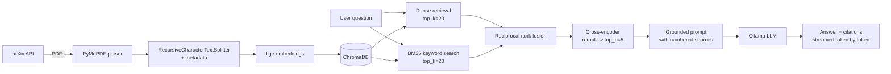
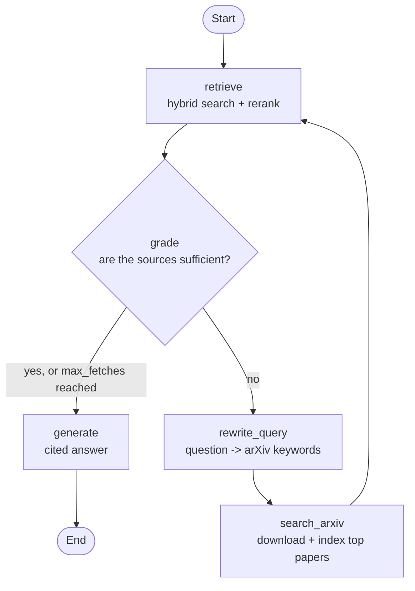

# arXiv RAG - ask machine-learning papers, get cited answers

A retrieval-augmented generation system that answers questions over a corpus of
arXiv papers and **grounds every answer in cited sources**. Runs fully locally and
free with [Ollama](https://ollama.com) - no API keys, no per-token costs.

Built to demonstrate a production-shaped RAG pipeline end to end: ingestion,
chunking, hybrid retrieval with cross-encoder reranking, grounded generation,
a corrective-RAG agent, an evaluation harness with confidence intervals, a REST API,
and a streaming UI.

---

## Built for Production

Most RAG demos stop at "embed a PDF and ask a question." This one adds the parts that
matter in practice:

- **Hybrid two-stage retrieval**: dense (bi-encoder) and BM25 keyword recall fused with
  reciprocal rank fusion, then a cross-encoder reranker. Each component's lift is
  *measured*, not assumed.
- **Grounded generation with citations**: the model must answer only from retrieved
  context and cite sources inline `[1][2]`, or explicitly abstain.
- **Evaluation with statistics**: Hit@k and MRR for retrieval, an LLM-as-judge
  faithfulness score (structured output), 95% bootstrap confidence intervals and
  paired lifts, on a 200-question synthetic set.
- **Built on LangChain**: the pipeline is an LCEL chain, the retriever is a custom
  `BaseRetriever`, storage and embeddings use the standard `Chroma` /
  `HuggingFaceEmbeddings` integrations, and everything is traceable in LangSmith.
- **Corrective-RAG agent (LangGraph)**: when the indexed papers can't answer, the agent
  rewrites the question, fetches and indexes new arXiv papers, and retries.
- **Swappable LLM backend**: the LLM comes from `init_chat_model`, so moving from
  Ollama to Claude/OpenAI is two env vars (`RAG_LLM_PROVIDER`, `RAG_LLM_MODEL`).
- **Servable**: FastAPI endpoint + token-streaming Streamlit UI + Docker Compose (app + Ollama).

---

## Architecture



**Stack:** Python · uv · LangChain · LangGraph · LangSmith · sentence-transformers
(`bge-small-en-v1.5`, `ms-marco-MiniLM-L-6-v2` cross-encoder) · rank-bm25 · ChromaDB ·
Ollama · FastAPI · Streamlit · Docker

---

## Quickstart

> Run every command from the project root (the folder with this README). Dependencies are
> managed with [uv](https://docs.astral.sh/uv/); `uv run` uses the locked environment automatically.

### 1. Install
```bash
uv sync                     # creates .venv from uv.lock (add a package with: uv add <pkg>)
cp .env.example .env        # optional: override settings, enable LangSmith
```

### 2. Start a local LLM
```bash
# install Ollama from https://ollama.com, then:
ollama pull llama3.1
```

### 3. Build the index
```bash
uv run scripts/build_index.py \
  --query "cat:cs.LG AND abs:retrieval augmented generation" --max 30
```

### 4. Ask
```bash
uv run scripts/ask.py "What is the difference between a bi-encoder and a cross-encoder?"
```

Or launch the UI / API:
```bash
uv run streamlit run src/app/streamlit_app.py      # http://localhost:8501 (streams the answer)
uv run uvicorn src.api.main:app --reload           # http://localhost:8000/docs
```

### 5. Agent, fetches new papers when the index can't answer

A corrective-RAG loop built with LangGraph: after retrieving, a grader decides whether the
sources can answer the question. If the best chunk's cross-encoder score is below a calibrated
threshold (`RAG_AGENT_MIN_RERANK_SCORE`, default -1), the sources are off-topic and the agent
fetches without asking the LLM; otherwise the LLM judges whether they actually answer it. To
fetch, the LLM extracts key phrases, which become a scoped arXiv query
(`abs:"FlashAttention" AND abs:"GPU memory" AND cat:cs.*`, relaxed if it returns nothing);
the top papers are downloaded and indexed, and retrieval runs again. `max_fetches`
(default 1) bounds the loop so a strict grader can't make it run forever.



```bash
uv run scripts/agent.py "What is speculative decoding for faster LLM inference?"
uv run scripts/agent.py --graph                    # print the LangGraph as Mermaid
```
```
-> retrieve 5 sources
-> grade NOT sufficient
-> rewrite_query 'speculative decoding LLM inference acceleration'
-> search_arxiv indexed ['2503.00491v1', '2203.16487v6', '2508.17739v2']
-> retrieve 5 sources
-> grade ...
-> generate done
```
> Fetched papers are added to the main index, which changes evaluation results.

### Docker (app + Ollama together)
```bash
docker compose up --build
docker compose exec ollama ollama pull llama3.1
```

### Tracing with LangSmith (optional)
Set `LANGSMITH_TRACING=true` and `LANGSMITH_API_KEY` in `.env`. Every run of the chain
(`rag_chain`), the judge (`faithfulness_judge`) and the retriever then shows up at
[smith.langchain.com](https://smith.langchain.com) with inputs, outputs and latency per step.
Evaluation runs are tagged with their retrieval config.

---

## Evaluation

```bash
uv run eval/eval_dataset.py --n 200 --out eval/qa_set_200.jsonl     # synthetic QA set
uv run eval/evaluate.py --qa eval/qa_set_200.jsonl --hybrid --faithfulness --save eval/results_200.json
make overnight                                                       # both steps (~2 h on a laptop GPU)
```

Results on 200 questions over 30 papers (2,232 chunks), mean with 95% bootstrap CI:

| Retrieval config | Hit@5 | MRR | Faithfulness (judge) | Abstentions |
|------------------|:-----:|:---:|:--------------------:|:-----------:|
| Dense only       | 0.610 [0.545, 0.675] | 0.451 [0.394, 0.514] | 0.804 [0.746, 0.862] | 11 |
| Dense + reranker | 0.700 [0.635, 0.765] | 0.617 [0.555, 0.679] | 0.872 [0.826, 0.918] | 5 |
| Hybrid           | 0.750 [0.690, 0.805] | 0.554 [0.498, 0.609] | 0.872 [0.826, 0.918] | 5 |
| **Hybrid + reranker** (default) | **0.815** [0.760, 0.865] | **0.710** [0.653, 0.764] | 0.862 [0.811, 0.908] | 4 |

Paired bootstrap lifts (same questions, both systems; all intervals exclude 0):

| Comparison | Δ Hit@5 | Δ MRR |
|------------|:-------:|:-----:|
| Hybrid + reranker vs dense only | +0.205 [+0.145, +0.265] | +0.258 [+0.198, +0.317] |
| Hybrid + reranker vs dense + reranker (value of BM25) | +0.115 [+0.065, +0.165] | +0.092 [+0.052, +0.136] |
| Hybrid + reranker vs hybrid (value of the reranker) | +0.065 [+0.020, +0.110] | +0.156 [+0.104, +0.205] |

**Reading the results**

- BM25 and the reranker are complementary: BM25 mostly raises **recall** (Hit@5: it
  surfaces chunks dense search missed: 26 questions fixed, 3 broken), the reranker
  mostly raises **ranking** (MRR: it moves the right chunk to the top).
- Any retrieval improvement cuts abstentions (11 -> 4-5) and appears to raise
  faithfulness, but faithfulness differences between the three improved configs are within noise.
- **Caveat:** the synthetic set is bootstrapped: the LLM writes a question answerable only
  from a sampled chunk, which becomes the gold passage. Such questions reuse the passage's
  exact wording, which flatters keyword search; real user questions paraphrase more, so
  the BM25 lift on real traffic is likely smaller.
- Migrating from hand-rolled code to LangChain did not change quality: query embeddings
  were identical. A small retrieval gain seen during migration was traced to the
  chromadb upgrade (HNSW recall@20 vs exact search: 0.84 -> 0.98).

---

## Project layout

```
src/
  config.py              # all tunables in one place (pydantic-settings + .env)
  ingest/                # arXiv loader · PDF -> Documents · text splitter · indexer
  retrieval/             # HuggingFaceEmbeddings · Chroma store · BM25 · RerankingRetriever (hybrid + RRF)
  generation/            # init_chat_model factory · streamable LCEL RAG chain
  agent/graph.py         # LangGraph corrective-RAG agent
  api/main.py            # FastAPI service
  app/streamlit_app.py   # streaming demo UI
scripts/                 # build_index.py · ask.py · agent.py
eval/                    # synthetic QA set + metrics harness (bootstrap CIs)
tests/                   # unit tests
pyproject.toml · uv.lock # dependencies, managed by uv
```

---
