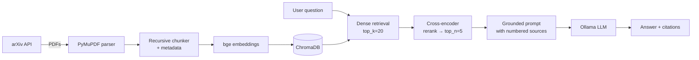

# arXiv RAG - ask machine-learning papers, get cited answers

A retrieval-augmented generation system that answers questions over a corpus of
arXiv papers and **grounds every answer in cited sources**. Runs fully locally and
free with [Ollama](https://ollama.com) — no API keys, no per-token costs.

Built to demonstrate a production-shaped RAG pipeline end to end: ingestion,
chunking, dense retrieval with cross-encoder reranking, grounded generation,
an evaluation harness, a REST API, and a UI.

---

## Why this is more than a toy

Most RAG demos stop at "embed a PDF and ask a question." This one adds the parts that
matter in practice:

- **Two-stage retrieval** — fast bi-encoder recall, then a cross-encoder reranker. The
  eval harness *quantifies the reranker's lift* so the design choice is measured, not assumed.
- **Grounded generation with citations** — the model must answer only from retrieved
  context and cite sources inline `[1][2]`, or explicitly abstain.
- **Evaluation built in** — Hit@k and MRR for retrieval, plus an LLM-as-judge
  faithfulness score for generation.
- **Swappable LLM backend** — the pipeline depends on an `LLM` protocol, so moving from
  Ollama to Claude/OpenAI is one class and one line.
- **Servable** — FastAPI endpoint + Streamlit UI + Docker Compose (app + Ollama).

---

## Architecture



**Stack:** Python · sentence-transformers (`bge-small-en-v1.5`) · cross-encoder reranker
· ChromaDB · Ollama · FastAPI · Streamlit · Docker

---

## Quickstart

> Run every command from the project root (the folder with this README). The entry-point
> scripts add the root to Python's path automatically, so `python scripts/...` just works.

### 1. Install
```bash
pip install -r requirements.txt
```

### 2. Start a local LLM
```bash
# install Ollama from https://ollama.com, then:
ollama pull llama3.1
```

### 3. Build the index
```bash
python scripts/build_index.py \
  --query "cat:cs.LG AND abs:retrieval augmented generation" --max 30
```

### 4. Ask
```bash
python scripts/ask.py "What is the difference between a bi-encoder and a cross-encoder?"
```

Or launch the UI / API:
```bash
streamlit run src/app/streamlit_app.py      # http://localhost:8501
uvicorn src.api.main:app --reload           # http://localhost:8000/docs
```

### Docker (app + Ollama together)
```bash
docker compose up --build
docker compose exec ollama ollama pull llama3.1
```

---

## Evaluation

```bash
python eval/eval_dataset.py          # bootstrap a synthetic QA set from the corpus
python eval/evaluate.py --faithfulness
```

Example output:

| Metric                | Dense only | + Reranker |
|-----------------------|:----------:|:----------:|
| Hit@5                 |    0.46    |    0.56    |
| MRR                   |    0.37    |    0.46    |
| Faithfulness (judge)  |     —      |    0.68    |

> The synthetic set is bootstrapped: the LLM writes a question answerable only from a
> sampled chunk, and that chunk becomes the gold passage.

---

## Project layout

```
src/
  config.py              # all tunables in one place (pydantic-settings)
  ingest/                # arXiv loader · PDF parsing · chunking
  retrieval/             # embeddings · ChromaDB store · reranking retriever
  generation/            # swappable LLM interface · RAG pipeline
  api/main.py            # FastAPI service
  app/streamlit_app.py   # demo UI
scripts/                 # build_index.py · ask.py
eval/                    # synthetic QA set + metrics harness
tests/                   # unit tests
```

---
